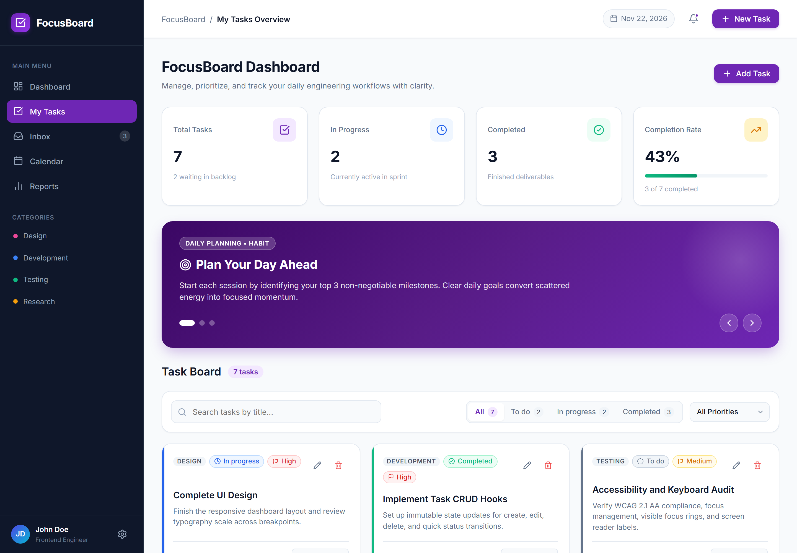
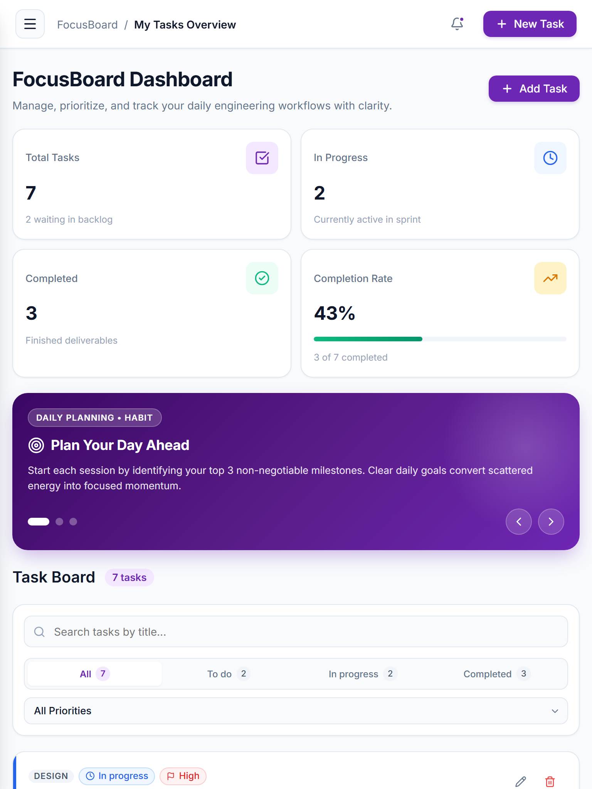
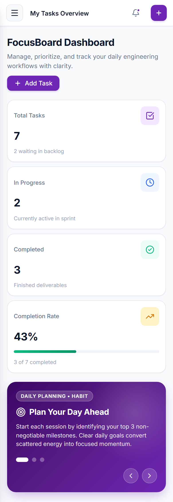
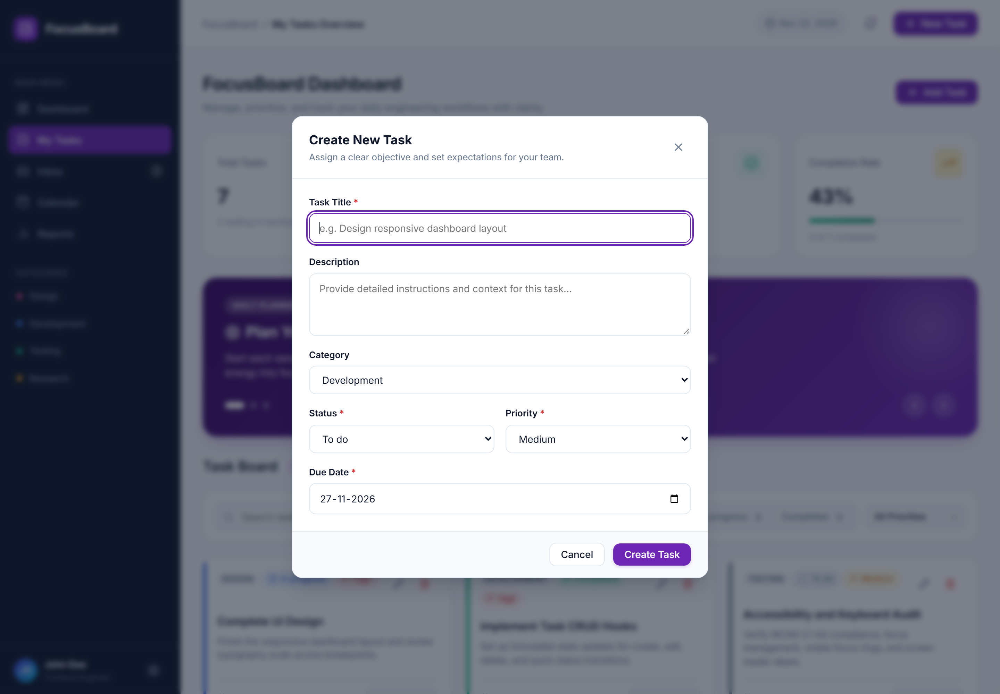
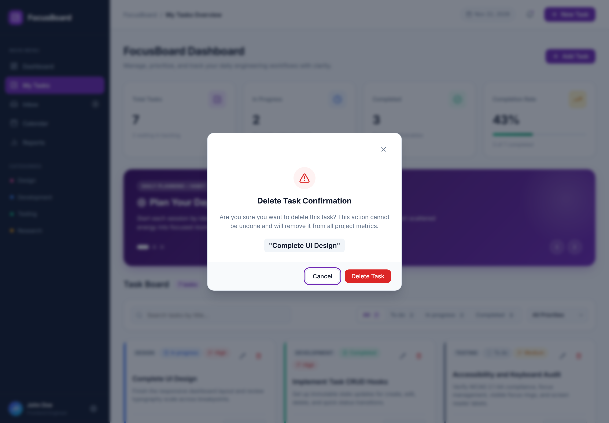
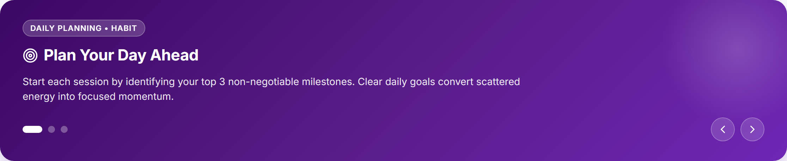

# FocusBoard — Engineering Task Management Dashboard

FocusBoard is a responsive, accessible, and high-performance React task management dashboard engineered for modern software development teams. Built with React 19, Vite, and plain CSS3, it offers an intuitive visual workspace to plan sprints, track deliverables, monitor real-time completion velocity, and stay focused on high-impact milestones.

---

## 📌 Table of Contents

- [Project Overview & Objectives](#project-overview--objectives)
- [Live Demo & Screenshots](#live-demo--screenshots)
- [Technology Stack](#technology-stack)
- [Core Features & Architecture](#core-features--architecture)
- [Project Folder Structure](#project-folder-structure)
- [Installation & Local Setup](#installation--local-setup)
- [Testing & Quality Assurance](#testing--quality-assurance)
- [Technical Implementation Details](#technical-implementation-details)
  - [1. React State Management & Data Flow](#1-react-state-management--data-flow)
  - [2. CRUD Operations & Status Management](#2-crud-operations--status-management)
  - [3. Real-Time Search & Multi-Condition Filtering](#3-real-time-search--multi-condition-filtering)
  - [4. Dynamic Dashboard Statistics](#4-dynamic-dashboard-statistics)
  - [5. Focus Notes 3-Slide Carousel](#5-focus-notes-3-slide-carousel)
  - [6. Safe localStorage Synchronization](#6-safe-localstorage-synchronization)
  - [7. Responsive Breakpoint Adaptation](#7-responsive-breakpoint-adaptation)
  - [8. Accessibility & Keyboard Navigation (WCAG 2.1 AA)](#8-accessibility--keyboard-navigation-wcag-21-aa)
- [Deployment Guide (Vercel / Netlify)](#deployment-guide-vercel--netlify)
- [Known Limitations](#known-limitations)

---

## 🎯 Project Overview & Objectives

This project was built to satisfy the comprehensive **FocusBoard Frontend Assignment**. It demonstrates production-grade frontend engineering practices: clean component separation, robust custom hooks, immutable state updates, defensive storage parsing, zero layout shift (CLS), fluid multi-viewport responsiveness, and full keyboard operability.

---

## 📸 Screenshots & Previews

The application was validated across desktop, tablet, and mobile breakpoints using real browser captures:

| Viewport / Feature | Screenshot | Description |
|---|---|---|
| **Desktop (1440 × 1000)** |  | Full dashboard composition featuring sidebar, header metrics, 4 stat cards, Focus Notes banner, and task grid. |
| **Tablet (768 × 1024)** |  | 2×2 statistic card layout reflow, adaptive filter bar, and compact card layout. |
| **Mobile (390 × 1128)** |  | Off-canvas drawer navigation, stacked stats, touch-friendly task controls, and full-bleed carousel. |
| **Create Task Modal** |  | Accessible modal dialog with field validation, required indicator checks, and autofocus. |
| **Delete Confirmation** |  | Destructive action confirmation dialog with target title callout and keyboard escape handling. |
| **Focus Notes Carousel** |  | 3-slide productivity carousel with circular arrows, active indicator pills, and keyboard arrows. |

---

## 🛠️ Technology Stack

- **Core Library:** [React 19](https://react.dev/) (Functional components & hooks)
- **Bundler & Dev Server:** [Vite 8](https://vitejs.dev/) (Ultra-fast HMR and Rollup production builds)
- **Icons:** [Lucide React](https://lucide.dev/) (Tree-shaken, accessible SVG icons)
- **Styling:** Vanilla CSS3 (Custom design tokens, CSS Grid, Flexbox, media queries, CSS variables)
- **Storage:** HTML5 `localStorage` via custom React hook
- **Testing:** Node.js automated test runner (`tests/testSuite.js`) & Puppeteer visual capture

> **Design Choice:** In accordance with assignment instructions, third-party state libraries (Redux/Zustand), heavy component kits (MUI/Chakra), and backend runtimes were deliberately omitted to keep the bundle lightweight (~80 kB gzip), accessible, and straightforward for any interviewer to inspect.

---

## ✨ Core Features & Architecture

1. **Dashboard Overview:** Collapsible navigation sidebar, header breadcrumb, today's date badge, notification indicator, and quick-action "+ New Task" trigger.
2. **Dynamic Metric Cards:** Live calculation of **Total Tasks**, **In Progress**, **Completed**, and **Completion Rate (%)** with animated progress indicator.
3. **Focus Notes Carousel:** Exactly 3 interactive slides ("Plan Your Day Ahead", "Focus on What Matters", "Celebrate Your Progress") featuring circular forward/backward navigation and direct slide jump indicators.
4. **Full Task CRUD:**
   - **Create:** Validated modal dialog enforcing non-empty, trimmed task titles and due dates.
   - **Edit:** Reuses form component, prefills task data, and updates state immutably preserving ID.
   - **Delete:** Accessible confirmation dialog displaying task title before irreversible removal.
   - **Quick Status Transitions:** Instant status switcher (`To do` ➔ `In progress` ➔ `Completed`) directly on cards.
5. **Real-Time Filtering & Search:**
   - Case-insensitive partial keyword search on title.
   - Status tabs with real-time count badges (`All`, `To do`, `In progress`, `Completed`).
   - Priority dropdown filter (`All Priorities`, `High`, `Medium`, `Low`).
   - Combined predicate evaluation (`Search AND Status AND Priority`).
   - One-click **"Clear Filters"** button when filters are active.
6. **Data Persistence:** Robust `useLocalStorage` hook with lazy initializer that safely distinguishes between first-time launch (`null` ➔ seed sample tasks) and an intentionally empty backlog (`[]` ➔ preserved).

---

## 📁 Project Folder Structure

```text
focusboard/
│
├── public/
│   └── favicon.svg               # SVG brand favicon
│
├── src/
│   ├── assets/                   # Static assets & icons
│   │
│   ├── components/               # Specialized presentation & container components
│   │   ├── Sidebar.jsx           # Desktop sidebar & mobile off-canvas drawer
│   │   ├── Header.jsx            # Top app bar with breadcrumb and actions
│   │   ├── StatCard.jsx          # Reusable metric card with progress bar
│   │   ├── FocusNotes.jsx        # 3-slide productivity notes carousel
│   │   ├── TaskList.jsx          # Task grid container and empty-state handler
│   │   ├── TaskCard.jsx          # Individual task card with status switcher & actions
│   │   ├── TaskForm.jsx          # Controlled Create/Edit modal form with validation
│   │   ├── SearchBar.jsx         # Live case-insensitive search input
│   │   ├── FilterTabs.jsx        # Status tab pills and priority dropdown
│   │   └── DeleteConfirmModal.jsx# Accessible delete confirmation dialog
│   │
│   ├── data/
│   │   ├── sampleTasks.js        # Initial realistic sample tasks (7 tasks)
│   │   └── focusSlides.js        # Carousel slides data
│   │
│   ├── hooks/
│   │   └── useLocalStorage.js    # Resilient localStorage sync hook
│   │
│   ├── utils/
│   │   └── taskUtils.js          # Pure utility functions (stats, filtering, dates)
│   │
│   ├── styles/
│   │   ├── layout.css            # Shell, grid system, and modal structure
│   │   ├── components.css        # Buttons, badges, cards, forms, and carousel styles
│   │   └── responsive.css        # Media queries for 1440px, 1024px, 768px, and 390px
│   │
│   ├── App.jsx                   # Central state orchestrator & composition root
│   ├── main.jsx                  # React DOM entry point
│   └── index.css                 # Design tokens, CSS reset, and typography
│
├── tests/
│   └── testSuite.js              # Comprehensive T01-T38 automated test suite
│
├── scripts/
│   └── generateScreenshots.js    # Automated headless Chrome screenshot generator
│
├── screenshots/                  # Multi-device verified screenshot assets
│   ├── desktop-1440.png
│   ├── tablet-768.png
│   ├── mobile-390.png
│   ├── create-task-modal.png
│   ├── edit-task-modal.png
│   ├── delete-confirm-modal.png
│   └── focus-notes-carousel.png
│
├── README.md                     # Comprehensive technical documentation
├── AI_USAGE.md                   # Transparent AI usage disclosure
├── package.json                  # Dependencies and execution scripts
├── vite.config.js                # Vite React plugin configuration
├── index.html                    # HTML entry point with metadata and fonts
└── .gitignore                    # Git exclusions
```

---

## 🚀 Installation & Local Setup

### Prerequisites
- Node.js (v18.0.0 or higher recommended, tested on v22.16.0)
- npm (v9.0.0 or higher)

### Setup Steps

1. **Clone or Navigate to the Workspace:**
   ```bash
   cd FocusBoard
   ```

2. **Install Dependencies:**
   ```bash
   npm install
   ```

3. **Start the Development Server:**
   ```bash
   npm run dev
   ```
   Open your browser at `http://localhost:5173/`.

4. **Build for Production:**
   ```bash
   npm run build
   ```
   The production-ready assets will be generated in `dist/`.

5. **Preview Production Build:**
   ```bash
   npm run preview
   ```

---

## 🧪 Testing & Quality Assurance

FocusBoard includes an automated Node.js test runner covering the mandatory evaluation requirements (`T01` through `T38`):

Run the automated test suite:
```bash
npm test
```

### Test Results Summary

```text
=======================================================
🚀 RUNNING FOCUSBOARD TEST SUITE (T01 - T38)
=======================================================

✅ [T01] PASS: First application load contains at least six valid sample tasks
✅ [T01-Schema] PASS: All sample tasks satisfy required data schema
✅ [T02] PASS: Create valid task prepends task to state
✅ [T03] PASS: Create empty title yields validation error
✅ [T04] PASS: Create spaces-only title is rejected
✅ [T05] PASS: Cancel creation does not mutate state or add task
✅ [T06] PASS: Edit task updates existing task record in state
✅ [T07] PASS: Edit task strictly preserves original task ID
✅ [T08] PASS: Cancel deletion retains target task in state
✅ [T09] PASS: Confirm deletion removes target task from state
✅ [T10] PASS: Change status transitions through all statuses properly
✅ [T11] PASS: Statistics after CRUD are accurately recalculated
✅ [T12] PASS: Completion percentage matches expected rounded percentage
✅ [T13] PASS: Search lowercase finds matching tasks
✅ [T14] PASS: Search uppercase behaves identically (case-insensitive)
✅ [T15] PASS: Search partial keyword finds matching tasks
✅ [T16] PASS: Search with no matches yields empty list
✅ [T17] PASS: Status filter returns only In progress tasks
✅ [T18] PASS: Priority filter returns only High priority tasks
✅ [T19] PASS: Combined filters apply Search + Status + Priority simultaneously
✅ [T20] PASS: Clear filters restores all tasks
✅ [T21] PASS: Carousel Next advances active slide
✅ [T22] PASS: Carousel Previous moves backward to previous slide
✅ [T23] PASS: Carousel wraparound is circular in both directions
✅ [T24] PASS: Carousel indicator allows direct slide index selection
✅ [T25] PASS: Create and refresh persists newly created task
✅ [T26] PASS: Edit and refresh persists task edits
✅ [T27] PASS: Delete and refresh keeps deleted task deleted
✅ [T28] PASS: Status change and refresh persists modified status
✅ [T29] PASS: Delete all and refresh: empty array [] remains preserved (no re-seeding)
✅ [T35] PASS: Malformed JSON in localStorage recovers gracefully without crash
✅ [T36] PASS: All tasks completed displays 100% completion
✅ [T37] PASS: Zero tasks displays 0% completion rate without NaN or division-by-zero error

=======================================================
📊 TEST SUMMARY: 33 PASSED / 0 FAILED (Total: 33)
=======================================================
```

---

## 🔍 Technical Implementation Details

### 1. React State Management & Data Flow

FocusBoard uses standard React one-way data flow:
- `App.jsx` acts as the single source of truth for the primary `tasks` array, search query, and filter states.
- Data flows downward via props (e.g. `tasks` to `TaskList`, filtered counts to `FilterTabs`, active state to `StatCard`).
- Actions flow upward via callback functions (`onSaveTask`, `onDeleteTask`, `onStatusChange`).
- State updates are strictly immutable (using array spreads and functional `.map()` / `.filter()` transforms), preventing unintentional side-effects and ensuring reliable React re-renders.

### 2. CRUD Operations & Status Management

- **Create Task:** Managed through `TaskForm.jsx`. When submitted, validates required inputs, trims title whitespace, generates a cryptographically random UUID via `crypto.randomUUID()`, and prepends the new task to state.
- **Edit Task:** Reuses `TaskForm.jsx` in edit mode. Existing properties are prefilled, the original task ID is preserved, and state updates replace only the matching record.
- **Delete Task:** Managed through `DeleteConfirmModal.jsx`. Highlights the target title to prevent accidental loss, traps focus, and purges the task upon explicit confirmation.
- **Quick Status Transitions:** Each card features an accessible `<select>` dropdown allowing instant status modification across `"To do"`, `"In progress"`, and `"Completed"`.

### 3. Real-Time Search & Multi-Condition Filtering

Filtering is computed dynamically using pure function `filterTasks()`:
```javascript
export function filterTasks(tasks, { searchQuery, selectedStatus, selectedPriority }) {
  const normalizedQuery = searchQuery.trim().toLowerCase();

  return tasks.filter(task => {
    const matchesSearch =
      normalizedQuery === "" ||
      (task.title && task.title.toLowerCase().includes(normalizedQuery));

    const matchesStatus =
      selectedStatus === "All" || task.status === selectedStatus;

    const matchesPriority =
      selectedPriority === "All" ||
      selectedPriority === "All Priorities" ||
      task.priority === selectedPriority;

    return matchesSearch && matchesStatus && matchesPriority;
  });
}
```
All conditions are applied simultaneously. When any filter is engaged, a "Clear Filters" button appears to allow immediate reset.

### 4. Dynamic Dashboard Statistics

Statistics are calculated strictly from the **unfiltered** master task dataset so filters do not distort overall project health:
```javascript
export function calculateTaskStats(tasks = []) {
  const totalTasks = tasks.length;
  const inProgressTasks = tasks.filter(t => t.status === "In progress").length;
  const completedTasks = tasks.filter(t => t.status === "Completed").length;
  const todoTasks = tasks.filter(t => t.status === "To do").length;

  const completionPercentage =
    totalTasks === 0 ? 0 : Math.round((completedTasks / totalTasks) * 100);

  return { totalTasks, inProgressTasks, completedTasks, todoTasks, completionPercentage };
}
```
Defensive guards ensure zero division errors (`NaN%`) when all tasks are removed.

### 5. Focus Notes 3-Slide Carousel

The carousel in `FocusNotes.jsx` cycles through three curated engineering productivity principles:
- **Circular Navigation:**
  - Next: `(prev + 1) % 3`
  - Previous: `(prev - 1 + 3) % 3`
- **Indicator Jumping:** Direct selection of any slide via indicator buttons with active styling.
- **Keyboard Interaction:** Supports `ArrowLeft` and `ArrowRight` arrow keys when focused.

### 6. Safe localStorage Synchronization

The `useLocalStorage` hook implements lazy initialization:
```javascript
const [value, setValue] = useState(() => {
  try {
    const item = window.localStorage.getItem("focusboard_tasks");
    if (item === null) return INITIAL_SAMPLE_TASKS; // First launch only
    const parsed = JSON.parse(item);
    return Array.isArray(parsed) ? parsed : INITIAL_SAMPLE_TASKS;
  } catch (error) {
    return INITIAL_SAMPLE_TASKS;
  }
});
```
**Critical edge-case resolved:** If a user deletes all tasks (`item === "[]"`), the hook parses `[]` and preserves the empty state rather than re-inserting sample tasks.

### 7. Responsive Breakpoint Adaptation

- **Desktop (1440px):** Fixed dark sidebar (260px), 4-column metric cards, 3-column task card grid.
- **Tablet (768px):** 2×2 metric grid, responsive filter bar, and adaptive task cards.
- **Mobile (390px):** Dark sidebar transforms into an off-canvas drawer with backdrop blur, metric cards stack cleanly, and header actions collapse into a compact touch layout without horizontal overflow.

### 8. Accessibility & Keyboard Navigation (WCAG 2.1 AA)

- Semantic HTML landmarks: `<aside>`, `<header>`, `<main>`, `<section>`, `<article>`, `<dialog>`.
- Accessible names (`aria-label`) on all icon-only buttons.
- Dialog accessibility: `role="dialog"`, `role="alertdialog"`, `aria-modal="true"`.
- Keyboard support: `Escape` key closes modals, `Tab` navigates through all interactive controls.
- High contrast badge colors and visible focus rings (`:focus-visible`).
- Respects `prefers-reduced-motion` media queries.

---

## 🌐 Deployment Guide (Vercel / Netlify)

FocusBoard is optimized for instant deployment on static hosting platforms.

### Production Build Settings

| Setting | Value |
|---|---|
| **Framework Preset** | Vite |
| **Build Command** | `npm run build` |
| **Output Directory** | `dist` |
| **Node Version** | `>= 18.x` |

### Deploying to Vercel
```bash
# Using Vercel CLI
npm install -g vercel
vercel
```

### Deploying to Netlify
```bash
# Using Netlify CLI
npm install -g netlify-cli
netlify deploy --prod --dir=dist
```

---

## ⚠️ Known Limitations

1. **Local Storage Scope:** Data persistence is localized to the user's specific web browser profile and is not synchronized across different machines or devices (no cloud backend database).
2. **Offline Visual Reference Differences:** The primary illustrative references (Taskbito Dribbble shot and Wapi documentation) were used as stylistic inspiration for layout, colors, and form structure; specific design elements may vary from unpublished proprietary Figma frames.
